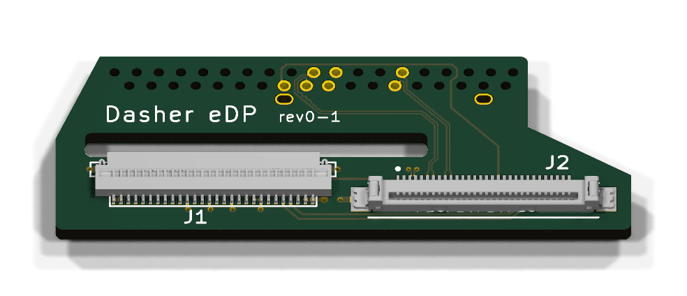

# Dasher eDP Mod

A mod that adds eDP to the X230. Soldered to the mainboard it turns the second DisplayPort of the docking port into an eDP port.

Unlike other mods this one is entirely passive (it's just a PCB with 2 connectors, nothing else) and was designed to be used with [Coreboot](https://www.coreboot.org/). That enables it to provide the best possible user experience, including:

* Working brightness control via ACPI
* Display works in firmware, at full resolution
* No extra power draw, the panel is only powered when needed

You can find the schematic as PDF in [doc/schematic.pdf](doc/schematic.pdf).

## License

Copyright (c) 2020-2026 Jens Mölzer.

This project is licensed under the CERN Open Hardware Licence Version 2 – Permissive (CERN-OHL-P-2.0), see [LICENSE](LICENSE).

**Exception:** The files in `dasher-edp.3d/` and `datasheets/` are **not** my work and are therefore **not** covered by this license.

## Similar Works

* [nitrocaster FHD mod](https://web.archive.org/web/20260723215018/https://nitrocaster.me/store/x220-x230-fhd-mod-kit.html): Demonstrated feasibility and inspired this work. Uses a microcontroller.
* Various others (see e.g. [here](https://github.com/lethedata/x220_x230-Mod_Kits) for a list) that all use active components and ugly hacks for brightness control.
